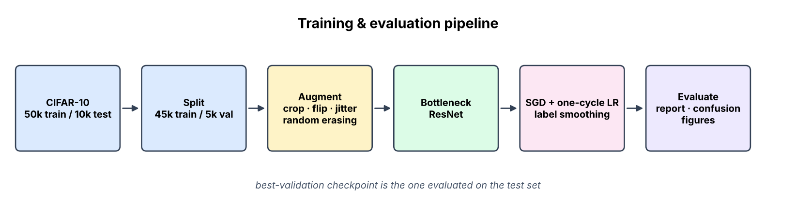
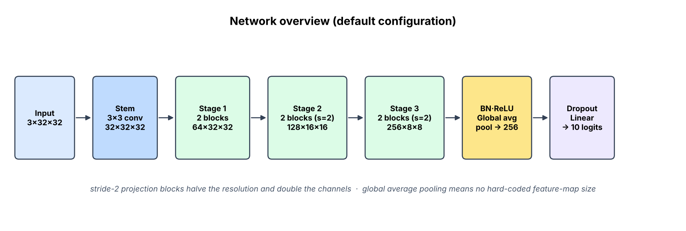
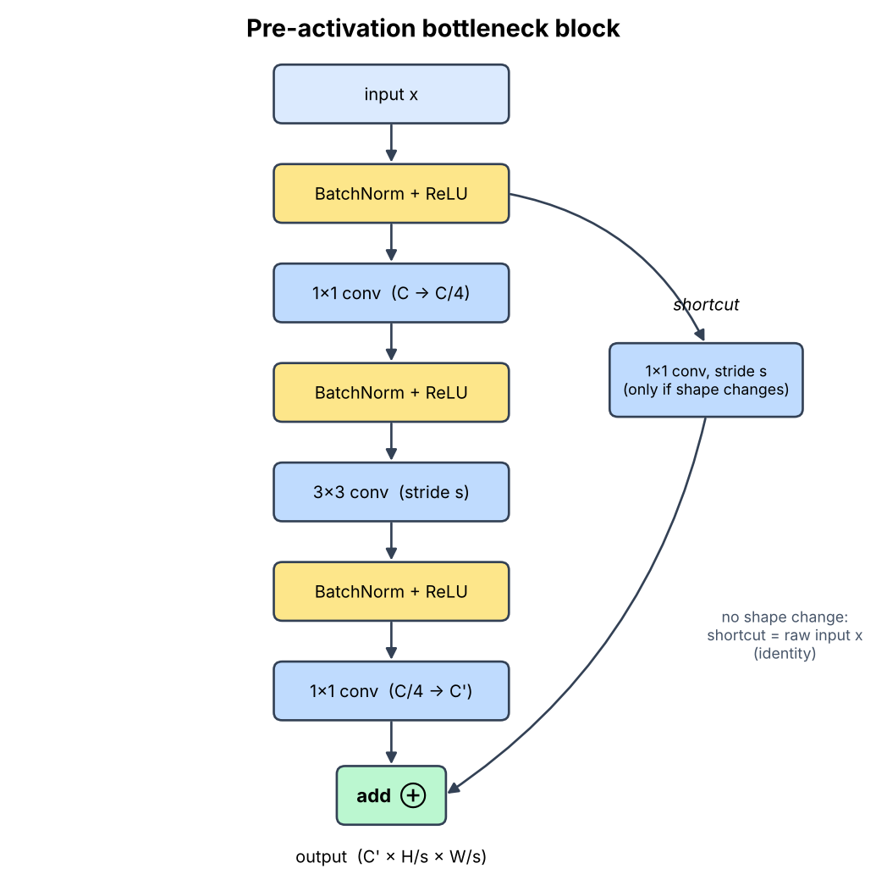
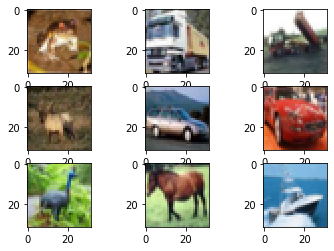
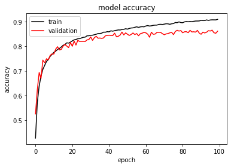
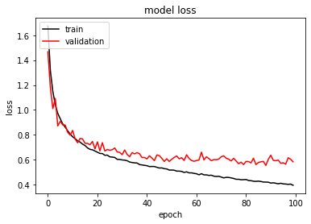
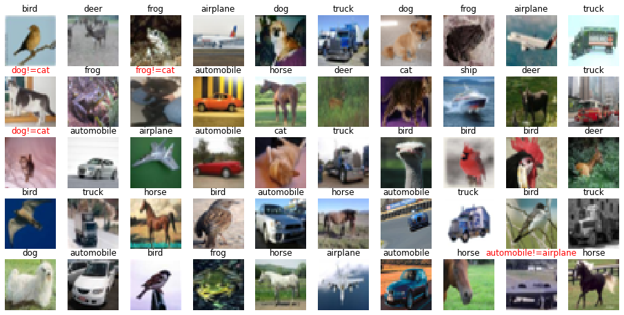

# CIFAR-10 Image Classification with Bottleneck ResNet

A compact, readable PyTorch implementation of a **pre-activation bottleneck ResNet** for the
[CIFAR-10](https://www.cs.toronto.edu/~kriz/cifar.html) dataset (60,000 colour images, 32×32 px, 10 classes)
Everything — data split, augmentation, model, schedule, evaluation and figures — is configurable from one place and runnable with a single command

<p align="center">
  
</p>

## Highlights

- **Pre-activation bottleneck blocks** (`BN → ReLU → conv`) with 1×1 / 3×3 / 1×1 convolutions.
- **Global average pooling**, so the network is not tied to one hard-coded feature-map size
- **Modern training recipe:** SGD + Nesterov momentum, one-cycle learning-rate schedule, label smoothing, weight decay and gradient clipping
- **Stronger augmentation:** random crop (reflect padding), horizontal flip, brightness/contrast jitter and random erasing
- **Reproducible:** seeded split and training; the exact config is saved next to every run
- **One-command evaluation** producing a classification report, confusion matrix, per-class F1 and a prediction gallery
- **Small by design:** the default model has about **0.22 M parameters** and trains on a laptop CPU or a free GPU

## Architecture

<p align="center">
  
</p>

| Stage | Output shape | Blocks | Notes |
|-------|--------------|:------:|-------|
| Input | 3 × 32 × 32 | – | normalised with CIFAR-10 channel statistics |
| Stem | 32 × 32 × 32 | – | single 3×3 convolution, no early down-sampling |
| Stage 1 | 64 × 32 × 32 | 2 | first block widens channels via a 1×1 projection |
| Stage 2 | 128 × 16 × 16 | 2 | first block uses stride 2 |
| Stage 3 | 256 × 8 × 8 | 2 | first block uses stride 2 |
| Head | 10 | – | BN → ReLU → global average pool → dropout → linear |

Each residual block is a bottleneck: a 1×1 convolution squeezes the channels to a quarter, a 3×3 convolution does the
spatial work on the thin tensor, and a final 1×1 convolution expands back. When the shape changes, the shortcut is a
strided 1×1 projection; otherwise it is the identity.

<p align="center">
  
</p>

The exact parameter count of any configuration can be checked without installing PyTorch:

```bash
python scripts/count_params.py                      # 221,226
python scripts/count_params.py --depths 3 4 6       # try a deeper variant
```

## Project structure

```text
.
├── resnet_cifar/
│   ├── __init__.py
│   ├── config.py        # TrainConfig dataclass, class names, dataset statistics
│   ├── model.py         # PreActBottleneck + CifarResNet + build_model()
│   ├── data.py          # datasets, train/val split, augmentation
│   ├── engine.py        # one-epoch loop and prediction collection
│   ├── train.py         # CLI: python -m resnet_cifar.train
│   ├── evaluate.py      # CLI: python -m resnet_cifar.evaluate
│   ├── predict.py       # CLI: classify a single image file
│   ├── plots.py         # matplotlib figures
│   └── utils.py         # seeding, device selection, helpers
├── scripts/
│   ├── make_diagrams.py # regenerates the diagrams in docs/images
│   └── count_params.py  # analytic parameter counter
├── notebooks/
│   └── walkthrough.ipynb
├── tests/
│   └── test_model.py
├── docs/images/         # diagrams and result screenshots used in this README
├── requirements.txt
└── README.md
```

## Quick start

```bash
# 1. create an environment and install dependencies
python -m venv .venv && source .venv/bin/activate      # Windows: .venv\Scripts\activate
pip install -r requirements.txt

# 2. train (the dataset is downloaded automatically on first use)
python -m resnet_cifar.train --epochs 30 --output-dir runs/default

# 3. evaluate the best checkpoint on the 10,000 test images
python -m resnet_cifar.evaluate --run-dir runs/default

# 4. classify your own picture
python -m resnet_cifar.predict --run-dir runs/default path/to/image.jpg
```

A training run writes the following into `runs/<name>/`:

| File | Content |
|------|---------|
| `config.json` | the exact hyper-parameters used |
| `best.pt` | weights of the epoch with the best validation accuracy |
| `history.json` | per-epoch loss, accuracy and learning rate |
| `metrics.json`, `classification_report.txt` | test accuracy and per-class scores |
| `figures/` | training curves, confusion matrix, per-class F1, prediction gallery |

Prefer notebooks? Open [`notebooks/walkthrough.ipynb`](notebooks/walkthrough.ipynb) for the same flow step by step

## Configuration

All options live in [`resnet_cifar/config.py`](resnet_cifar/config.py); the most common ones are also CLI flags.

| Option | Default | Meaning |
|--------|:-------:|---------|
| `epochs` | 30 | number of passes over the training set |
| `batch_size` | 128 | mini-batch size |
| `max_lr` | 0.1 | peak learning rate of the one-cycle schedule |
| `weight_decay` | 5e-4 | L2 regularisation strength |
| `label_smoothing` | 0.1 | softens one-hot targets |
| `stage_widths` | 64 128 256 | output channels per stage |
| `stage_depths` | 2 2 2 | residual blocks per stage |
| `val_size` | 5000 | images held out for validation |
| `seed` | 42 | seed for the split, initialisation and shuffling |

Example — a deeper, wider model:

```bash
python -m resnet_cifar.train --stage-widths 128 256 512 --stage-depths 3 4 3 --epochs 60
```

## Dataset

CIFAR-10 contains 60,000 images in 10 mutually exclusive classes — **airplane, automobile, bird, cat, deer, dog, frog, horse, ship, truck** — split into 50,000 training and 10,000 test images. This project further holds out 5,000 of the training images (fixed seed) for validation, leaving 45,000 for fitting

<p align="center">
  
</p>

## Results

| | Accuracy | Loss |
|---|:---:|:---:|
| Training | 90.9 % | 0.395 |
| Validation | 86.1 % | 0.584 |

**Learning curves (reference run)**

<p align="center">
  
  
</p>

**Random test images with predictions (reference run).** Titles in red are mistakes, shown as `predicted != true`
In that sample 46 of 50 images were classified correctly

<p align="center">
  
</p>

**Where reference-run validation scores were weakest:** *cat* (F1 0.71) and *dog* (0.79), which are visually similar; *automobile* (0.93), *ship* (0.92) and *truck* (0.92) were the strongest

## Tests

```bash
pytest -q
```

The tests check block and network output shapes, support for other input resolutions, the documented parameter count, and that a few optimisation steps reduce the loss on a tiny batch.

## Design notes & ideas

- **Why pre-activation?** Normalising and activating *before* each convolution leaves the shortcut path completely
  clean, which eases optimisation of deeper stacks.
- **Why global average pooling?** It removes the fixed pooling window of the classic head, so changing the
  stem or the number of stages can never break the classifier.
- **Why a one-cycle schedule?** A warm-up followed by annealing usually reaches a good solution in far fewer
  epochs than a fixed exponential decay.
- Things worth trying next: mixed precision, MixUp/CutMix, exponential moving average of weights, test-time
  augmentation, wider/deeper variants via the CLI flags.

## References

- K. He et al., *Deep Residual Learning for Image Recognition*, CVPR 2016
- K. He et al., *Identity Mappings in Deep Residual Networks*, ECCV 2016
- A. Krizhevsky, *Learning Multiple Layers of Features from Tiny Images*, 2009 — the CIFAR-10 dataset
